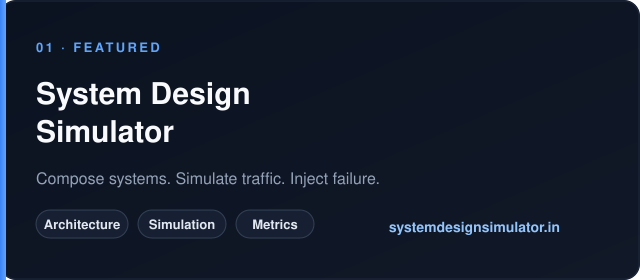
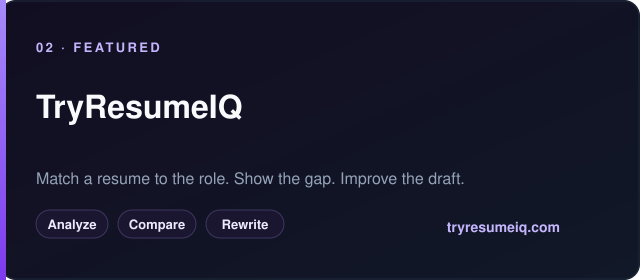

<h3 align="center">
  <samp>
    &gt; <b><a href="https://www.linkedin.com/in/rasharma5076/">Rahul Sharma</a></b>
    · Software Engineer @ Microsoft
  </samp>
</h3>

  <samp>「 Backend systems, distributed architecture, and AI products that ship. 」</samp>

  
  
  
  
  

  <a href="https://systemdesignsimulator.in"><b>Simulator</b></a>
  &nbsp;·&nbsp;
  <a href="https://tryresumeiq.com"><b>TryResumeIQ</b></a>
  &nbsp;·&nbsp;
  <a href="https://www.linkedin.com/in/rasharma5076/"><b>LinkedIn</b></a>
  &nbsp;·&nbsp;
  <a href="https://topmate.io/rahul_sharma170"><b>Topmate</b></a>
  &nbsp;·&nbsp;
  <a href="https://x.com/rasharma7094"><b>X</b></a>

## About

I am a software engineer at Microsoft. Day to day that means backend services, cloud systems, data pipelines, and the operational work that keeps them dependable.

Outside that, I build products that force the same questions in public: how a design fails under load, how retrieval quality shows up for a user, and how an interface makes architecture legible.

- **Backend.** C#, .NET, REST APIs, distributed systems
- **Cloud & data.** Azure, Apache Spark, Kusto
- **AI engineering.** LLM applications, RAG, semantic search
- **Product surface.** React, TypeScript

## Selected work

<table>
  <tr>
    <td width="50%" valign="top">
      
        
      An interactive lab for system design: component graphs, request simulation, performance metrics, and failure injection.
        
      <a href="https://systemdesignsimulator.in"><b>Open the simulator</b></a>
    </td>
    <td width="50%" valign="top">
      
        
      An AI product that compares a resume to a job description, names the gaps, and helps improve the application.
        
      <a href="https://tryresumeiq.com"><b>Open TryResumeIQ</b></a>
    </td>
  </tr>
</table>
